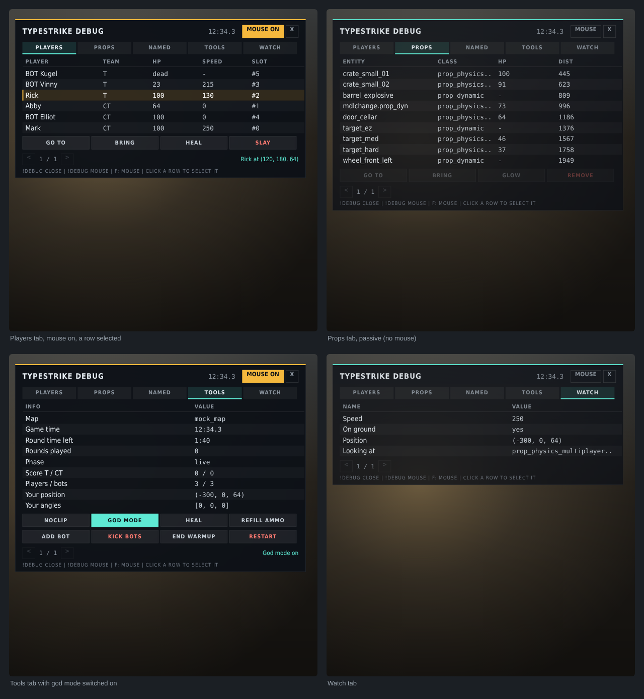

# typestrikelib

A TypeScript helper library for Counter-Strike 2's `cs_script` (`point_script`) scripting, built on Valve's `point_script.d.ts`.

Valve's API gives each script one think callback, one callback per game event, and plain `{ x, y, z }` vectors. This library adds the layer most map scripts end up writing themselves:

- events with multiple listeners
- timers
- vector and angle math
- typed entity wrappers
- chat commands
- per-player state
- save data
- an in-game debug menu built on custom HUD panels

## Setup

```sh
npm install
npm run build      # bundles src/index.ts -> scripts/bundle.js
npm run watch      # rebuild on save (pairs well with tools-mode hot reload)
npm run build:hud  # regenerates the debug menu's Panorama XML (after changing its slot counts)
npm run typecheck  # tsc over src/ and test/
npm test           # runs the library against a mock of cs_script/point_script
```

In Hammer, set your `point_script` entity's **cs_script** field to `scripts/bundle.vjs`.

```
src/
  index.ts          your map script (currently an example using the debug menu)
  lib/              the library — import from "./lib"
    core/           Events, Timers, Logger, onReload, Signal, Scope
    math/           Vec, Ang, colors, Random, scalar helpers
    entities/       find/cast helpers, EntityRef, fire/onOutput, Hammer entity wrappers, templates
    players/        player queries, Pawn helpers, PlayerData, Input, ChatCommands, Chat
    game/           Team, Round, Convars (+ presets), Weapons, Damage
    world/          traces, Camera, precache
    ui/             HudLayout, HudSync, DebugMenu (+ ready-made tabs), Draw, Watch
    util/           SaveStore, Stopwatch, Cooldown, formatTime
panorama/
  layout/custom_game/typestrike_debug.xml   debug menu layout (generated)
  styles/custom_game/typestrike_debug.css   debug menu styles
tools/              generate-debug-layout.mjs
test/               mock runtime, tests and runner (no extra dependencies)
point_script.d.ts   Valve's API declarations (current version)
```

## Quick start

```ts
import { CSInputs } from "cs_script/point_script";
import { ChatCommands, Events, Input, Logger, PlayerData, Timers, Vec, getPlayerName, playerFromEntity } from "./lib";

const log = new Logger("mymap");
const kills = new PlayerData(() => 0);

Events.on("PlayerKill", ({ attacker }) => {
    const killer = playerFromEntity(attacker);
    if (killer) kills.set(killer, kills.get(killer) + 1);
});

ChatCommands.register("kills", (ctx) => ctx.reply(`You have ${kills.get(ctx.player)} kills`));
ChatCommands.enableHelp();

Input.onPressed(CSInputs.USE, (pawn) => log.info(getPlayerName(pawn), "is at", Vec.format(pawn.GetAbsOrigin())));

Timers.every(30, () => log.info("30 seconds passed"));
```

## What's in it

| Area | Highlights |
| --- | --- |
| **Events** | `Events.on/once/off/next("PlayerJump", ...)` for every `Instance.OnXxx`. Names and payload types come from the `.d.ts`. `ModifyPlayerDamage` results from several listeners are combined in order, and `abort` wins. A listener that throws doesn't stop the others. `Events.onScriptInput(name, ...)` handles `RunScriptInput`. |
| **Timers** | `Timers.after / every / at / nextTick / everyTick`, all cancellable. They run from the single `SetThink` slot, which only fires when a timer is due. Also `wait(s)`, `waitTicks(n)`, `waitUntil(pred, { timeout })` and `afterThinks(cb)`. |
| **Math** | `Vec.*` covers add/sub/scale, dot/cross, length/length2D, normalize, lerp, reflect, project, closest point, parse/format. `Ang.*` covers forward/right/up using Source conventions, `fromDirection`, `lookAt`, `localToWorld`/`worldToLocal`, and shortest-path lerp. Also colors (`hex`, `hsv`, `healthColor`) and `Random` (with a seeded generator). |
| **Entities** | `findByName / requireByName / findAllByName / findByClass` (typed by classname), `findInRadius`, `findNearest`, type guards (`isPlayerPawn`, `isWeapon`, ...), `fire(target, input, value, { delay })`, `onOutput / onceOutput / waitForOutput`, `spawnTemplate`. |
| **Hammer wrappers** | `CFuncTrackTrain`, `CPathTrack`, `CPropDynamic`, `CFuncMoveLinear`, `CFuncDoor`, `CFuncRotating`, `CFuncButton`, `CTriggerMultiple`, `CLogicRelay`, `CMathCounter`, `CPointWorldText`. Each has typed methods for that entity's inputs and outputs. |
| **Players** | `getPlayers({ team, alive, bots })`, `getPawns`, `findPlayer("#3" or name)`, `playerFromEntity(attacker)`, `PlayerData<T>` (cleared on disconnect), `Input.onPressed/onReleased/onHeld`, `Pawn.heal / freeze / setNoclip / teleport / push / speed2D / lookAt`. |
| **Chat** | `ChatCommands.register(name, { aliases, usage, minArgs, teams, requireAlive, cooldown, handler })`, quoted arguments, `ctx.int/float/targetPlayer`, built-in help, and a pluggable reply handler. `Chat.say` cleans the text first, so typed `;` can't inject console commands. |
| **Game** | `Team` constants, `Round.win(team) / draw / addTime / isLive`, `Convars.apply(values)` → snapshot → `Convars.restore`, `ConvarPresets.kz / sandbox`, `Weapons.stripWeapons / refillAmmo / enableInfiniteAmmo`, `Damage.preventDamage / scaleDamage / pierceArmor / isHeadshot`. |
| **World** | `traceFromEyes`, `getAimTarget`, `hasLineOfSight`, `findGround`, `canPlayerFit`, `traceBulletFromEyes`, and `Camera.thirdPerson / fixed / follow / reset`. |
| **UI & debug** | `DebugMenu` (see below). `HudLayout` (custom_hud_layout text, classes, clicks, per-player overrides) and `HudSync` (only sends what changed) for your own HUDs. `Draw.line/arrow/axes/box/trace/text` and `Watch.set(key, value)` for dev-only overlays. |
| **Persistence** | `SaveStore<T>` saves typed JSON with defaults, versioning and migration, plus a merged `saveSoon()` write. `onReload` and `persistentState` keep state across tools-mode reloads. `EntityRef` re-finds named entities after they respawn. |

## Debug menu

`DebugMenu` is an in-game panel built from Panorama XML and CSS through a `custom_hud_layout`. Unlike `DebugScreenText`, it works in real matches, not only in dev environments. Each player gets their own view:

- tabs, each with a paged table (12 rows × up to 5 columns),
- click a row to select it,
- up to 8 action buttons per tab,
- a status line.

The menu sits on the right of the screen and doesn't block movement. Switch on the mouse cursor (the **MOUSE** button, `!debug mouse`, or a key you pick) to click things.



**Map setup (once):** in Hammer, add a `custom_hud_layout` entity named `typestrike_debug` and set its layout to `panorama/layout/custom_game/typestrike_debug.vxml`. The XML and CSS live in this addon's `panorama/` folder and are compiled like Valve's `welcome.xml`.

```ts
import { CSInputs } from "cs_script/point_script";
import { DebugMenu, entityTab, playersTab, toolsTab, Pawn } from "./lib";

const debug = new DebugMenu({ cursorKey: CSInputs.LOOK_AT_WEAPON }); // F toggles the mouse
debug.addTab(playersTab());                                          // go to / bring / heal / slay
debug.addTab(entityTab("Props", { className: "prop_physics_multiplayer" })); // go to / bring / glow / remove
debug.addTab(toolsTab());                                            // noclip, god mode, ammo, bots, round control
debug.watch("Speed", ({ pawn }) => pawn && Math.round(Pawn.speed2D(pawn)));

// Your own tab: rows are recomputed for each viewer every refresh.
debug.addTab({
    title: "Waves",
    columns: ["Wave", "Alive", "Spawned"],
    rows: () => waves.map((w) => ({ key: w.id, data: w, cells: [w.name, w.alive, w.spawned] })),
    onSelect: (row) => `Wave ${row.data!.name}`,
    actions: [{ label: "Kill wave", needsSelection: true, danger: true, run: ({ selected }) => killWave(selected!.data!) }],
});
```

Players type `!debug` in chat to open or close it, and `!debug <tab>` to jump to a tab. For local testing, the console command `ts_debug` (same arguments) does the same for the first human player; it's a cheat command, so it needs `sv_cheats 1`. Pass `allow: (player) => ...` to restrict the menu on public servers. Redraws send only the dialog variables and classes that changed. Nothing runs while nobody has the menu open.

**If it doesn't open, check the console.** After the map loads you should see:

```
[typestrikelib] loaded
[typestrike] Debug menu ready (HUD entity "typestrike_debug" found): type !debug in chat or ts_debug in the console (sv_cheats 1).
```

Each `!debug` logs what it did, e.g. `[typestrike] !debug: opened the debug menu for Mark`.

| What you see | What it means |
| --- | --- |
| No `[typestrikelib] loaded` | The script didn't run. Check that the point_script's cs_script is `scripts/bundle.vjs`, and look for a cs_script error above. |
| `WARN: ... has no X, Y` | Your CS2 build lacks those exports. Only the features that use them are affected. |
| `no custom_hud_layout named "typestrike_debug"` | The HUD entity is missing or named differently (or pass `layout: "yourname"`). |
| `Debug menu ready` but nothing on `!debug` | The chat message never reached the script. Try `ts_debug` in the console. |
| `opened the debug menu` but nothing on screen | The script side worked, so the problem is the Panorama layout: check the console for layout or CSS errors, and that the entity's layout is `typestrike_debug.vxml`. |

To change the number of tabs, rows, columns or actions, edit `src/lib/ui/debugMenu/layout.ts` and run `npm run build:hud`. `npm test` fails if the XML and `layout.ts` disagree.

## Things to know about cs_script

- **Let the library own `SetThink` and the event callbacks.** Valve's API has one think callback and one callback per event. Use `Timers` and `Events` instead of calling `Instance.SetThink` or `Instance.OnXxx` yourself, or you may replace the library's dispatcher.
- **Entity wrappers are prototype casts.** `castEntity(entity, CFuncTrackTrain)` (or `findByName(name, Cls)`) swaps the entity's prototype; it doesn't construct anything. So wrapper classes must:
  - extend the class the entity really is,
  - avoid constructors and field initialisers,
  - list `static classNames` so a wrong cast is caught early.
- **Tools-mode reloads** re-run your top level but keep entity objects and `globalThis`. Use `EntityRef` for entities you look up by name, `onReload` / `persistentState` for state, and re-cast entities after a reload (casting again updates them to the new code).
- **`Draw` and `Watch` only show in dev environments.** `DebugScreenText` positions are in pixels from the top-left. `DebugMenu` works everywhere.
- **Custom HUD layouts are fixed.** Labels take plain text through `{s:variable}` dialog variables, and there is no client-side scripting. So a layout needs a slot for everything it might show, and the script fills those slots and toggles classes.
- **There's no per-player chat print.** `Chat.say` uses the server `say` command, which goes to everyone. For per-player text, use a `HudLayout` (or `DebugMenu.setStatus`), or pass your own function to `ChatCommands.setReplyHandler`.
- **Named imports from `cs_script/point_script` are all-or-nothing.** If your CS2 build doesn't export a name you import (`import { GameRules } from ...`), the whole script fails to load. The library reads every engine value through one namespace import (`src/lib/core/engine.ts`) instead, so a missing export only breaks the feature that uses it, and a warning names it at load. Import `CSInputs`, `GameRules`, etc. from `"./lib"` to get the same safety in your own code. Types can still come from `cs_script/point_script`.
- **Tree shaking.** `src/lib/package.json` marks the library side-effect free, so esbuild only bundles what your script uses.

## Tests

`npm test` bundles each `test/*.test.ts` with esbuild, swapping in `test/mock/point_script.ts` (a fake runtime with game time, thinks, entities, players, convars and save data), and runs it in Node. `test/example.test.ts` runs `src/index.ts` itself against the mock. The mock's `CustomHudLayout` reads the real layout XML and tracks what each player sees, so the debug menu tests check what's on screen.

## Inspiration

- [s2ts](https://github.com/Peterclark1996/s2ts) and [cs2-typescript-addon-template](https://github.com/Nyx000/cs2-typescript-addon-template): TypeScript build setups and hot-reload tips.
- [func_vehicle_cs2](https://github.com/AZeed18/func_vehicle_cs2): name-convention entity setup, wildcard lookups, input polling.
- [CounterStrikeSharp](https://github.com/roflmuffin/CounterStrikeSharp): timers, chat commands and player utilities for server plugins.
- [z4lab custom UI](https://github.com/z4lab/z4lab-custom-ui): server-driven custom_hud_layout conventions (label id = dialog variable, `hittest="false"` labels inside buttons, hiding under the scoreboard).
- Valve's `cs_script_demo` addon (`welcome.xml`, `welcome.css`, `setup.js`): the custom HUD setup.
- [source2.wiki cs_script docs](https://www.source2.wiki/Scripting/Counter-Strike%202/cs_script/introduction) and Valve's `point_script.d.ts`.
